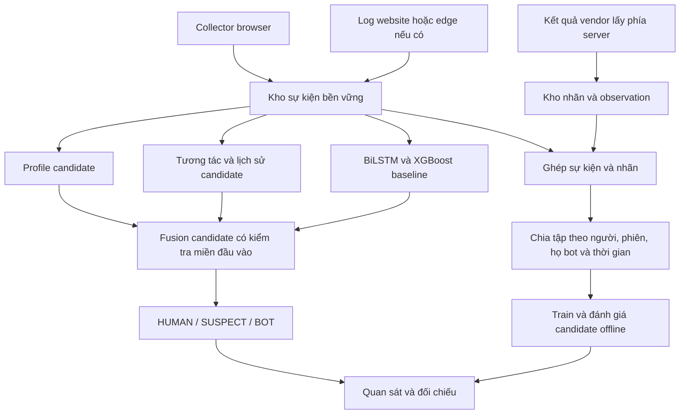

# Nghiên cứu bot detection thương mại và kế hoạch áp dụng vào DATACAT

Ngày nghiên cứu: 2026-10-12. Đối chiếu source tại commit `c2c9790`.

Đây là tài liệu nghiên cứu và thiết kế, không phải báo cáo đã tích hợp hay kết quả
benchmark các nhà cung cấp. Phạm vi gồm sáu hệ thống đại diện: Cloudflare,
DataDome, Fingerprint, Kasada, HUMAN và Akamai; không bao phủ toàn bộ thị trường.
Chỉ sử dụng tài liệu chính thức để mô tả sản phẩm. Các đề xuất cho DATACAT bên
dưới là thiết kế của dự án, không phải thuật toán nội bộ được nhà cung cấp công bố.

## 1. Kết quả lựa chọn

Giữ BiLSTM, XGBoost và heuristic hiện có làm baseline. Ưu tiên học từ các hãng
cách tổ chức bằng chứng: chất lượng dữ liệu, môi trường trình duyệt, chuỗi tương
tác, request nghiệp vụ và lịch sử theo phiên. Mỗi nhánh cần biết lúc nào nó có
đủ dữ liệu và lúc nào phải ngừng đưa ra kết luận.

Thứ tự đề xuất: **kho sự kiện và nhãn -> toàn vẹn dữ liệu -> profile và tương tác
shadow -> candidate XGBoost -> kiểm chứng fusion -> triển khai quan sát**.
Không cần GNN để thực hiện kế hoạch này. Không đổi ngưỡng chỉ nhằm giảm SUSPECT.

## 2. Các hệ thống hoạt động như thế nào?

### 2.1. Cloudflare Bot Management

Cloudflare mô tả nhiều engine phối hợp: heuristic, JavaScript và ML dùng đặc
trưng request, browser và phiên. Có cơ chế làm ổn định điểm theo lịch sử cookie.
Chi tiết trọng số và dữ liệu huấn luyện không được cung cấp trong tài liệu này.
[Nguồn: detection engines](https://developers.cloudflare.com/bots/concepts/bot-detection-engines/).

Sequence Rules theo dõi thứ tự thao tác và thời gian giữa các request; đây là
tín hiệu khác với hình học đường chuột.
[Nguồn: sequence rules](https://developers.cloudflare.com/bots/additional-configurations/sequence-rules/).

JA3/JA4 được hình thành từ kết nối TLS và có thể thiếu trên một số request.
[Nguồn: JA3/JA4](https://developers.cloudflare.com/bots/additional-configurations/ja3-ja4-fingerprint/).

**Lựa chọn cho DATACAT:** thử đặc trưng lịch sử có giới hạn thời gian, biết nguồn
dữ liệu và chống đếm lặp. Các bộ đếm theo phiên và endpoint có thể triển khai
trước; chưa có cơ sở để tái tạo threat intelligence toàn cầu của Cloudflare.

### 2.2. DataDome Bot Protect

DataDome công bố các nhóm phát hiện dựa trên signature, hành vi, reputation và
vulnerability scanner. Một số model áp dụng riêng cho login, tạo tài khoản,
giỏ hàng hoặc API. IP reputation được kết hợp với tín hiệu khác vì IP có thể
được dùng chung. [Nguồn: threat detection](https://docs.datadome.co/docs/threat-detection).

Log enrichment có request ID, phân loại bot và các trường bổ sung tùy gói.
Khi detection hoạt động và protection bị tắt, có thể quan sát kết quả giả định
mà request vẫn được cho qua.
[Nguồn: log enrichment](https://docs.datadome.co/docs/logs-integration).

**Lựa chọn cho DATACAT:** ghi loại trang/thao tác và đánh giá theo ngữ cảnh.
Ví dụ, nhịp truy cập lặp của trang danh mục cần baseline khác thao tác gửi form.
Cần log từ website để biết request nghiệp vụ; telemetry heartbeat không thay
thế được log này. Nhãn thương mại cần ghép theo sự kiện, không chỉ theo IP.

### 2.3. Fingerprint Bot Detection

Luồng JavaScript agent trả `event_id`; backend truy vấn Events API để nhận kết
quả. Kết quả phân biệt good bot, bad bot và bot not detected. Bad bot không tự
chứng minh ý định độc hại.
[Nguồn: bot detection](https://docs.fingerprint.com/docs/bot-detection/overview).

Fingerprint phân biệt replay payload gửi đến họ với việc tái sử dụng kết quả
trên API của ứng dụng. Kiểm tra kết quả phía server là một phần của tích hợp.
[Nguồn: payload replay](https://docs.fingerprint.com/docs/protecting-from-payload-replay-attacks),
[nguồn: client tampering](https://docs.fingerprint.com/docs/protecting-from-client-side-tampering).

**Lựa chọn cho DATACAT:** lưu nguồn của từng tín hiệu và tách nhãn nhà cung cấp
khỏi dữ liệu client tự khai. Dùng mã sự kiện, kiểm tra thời gian và liên kết đúng
website/phiên. Không dùng trường `isBot` do browser gửi làm nhãn train.

### 2.4. Kasada

Kasada mô tả thu tín hiệu client, kiểm tra phía server và Proof of Execution
thông qua các đường thực thi động trong máy ảo JavaScript được làm rối. Đây là
mô tả kiến trúc của nhà cung cấp, không phải mã nguồn hay bằng chứng tái hiện.
[Nguồn: architecture](https://www.kasada.io/bot-defense).

Họ cũng công bố cơ chế proof of work nhằm tăng chi phí request lạm dụng.
[Nguồn: API protection](https://www.kasada.io/use-cases/api-protection).

**Lựa chọn cho DATACAT:** bảo vệ liên kết giữa sự kiện, phiên và kết quả phân
tích trước. Không tự xây máy ảo chống giả mạo ở giai đoạn này. Challenge có
nonce giúp giới hạn replay nhưng không chứng minh dữ liệu mới là thật; chạy
được JavaScript hoặc giải được bài toán tính toán cũng không chứng minh HUMAN.

### 2.5. HUMAN Bot Defender

HUMAN mô tả ba phần: Sensor thu dữ liệu, Detector phân tích trên cloud và
Enforcer thực thi chính sách tại ứng dụng/load balancer/CDN. Kết quả có thể
được chuyển qua token/cookie bảo vệ hoặc trao đổi server-to-server.
[Nguồn: architecture](https://docs.humansecurity.com/applications/bd-overview).

Tín hiệu hành vi bao gồm thao tác chuột, touch, nhịp và thời gian.
[Nguồn: detection](https://docs.humansecurity.com/applications/bd-detection-overview).

**Lựa chọn cho DATACAT:** phân biệt kết luận phân loại và hành động ứng dụng.
Một bot hợp lệ vẫn là automation nhưng không nhất thiết phải chặn. Nếu sau
này phát hành token quyết định, server ký token; browser không giữ khóa ký.
Kết quả HUMAN trước đó chỉ có giá trị trong phạm vi và thời gian đã kiểm chứng.

### 2.6. Akamai Bot Manager

Akamai công bố các nhóm: bot được xác minh, bot do khách hàng định nghĩa,
transparent detection dựa vào request, active detection và behavioral detection
ở các endpoint giao dịch. Các nhóm này có thể dẫn tới hành động khác nhau.
[Nguồn: detection methods](https://techdocs.akamai.com/cloud-security/docs/detection-methods).

**Lựa chọn cho DATACAT:** thiết kế nhánh cho dữ liệu ít tương tác và kiểm chứng
riêng, thay vì giả định mọi client đều cung cấp một quỹ đạo chuột dài. Người
truy cập nhanh và người dùng công cụ hỗ trợ phải có mặt trong nhóm đối chứng.

### 2.7. Nghiên cứu Akamai sát với điểm mù của dự án

Nghiên cứu tháng 8/2026 là **PoC**, không phải bằng chứng một tính năng đã được
phát hành production. Tác giả dùng Masked Autoencoder Transformer học từ khoảng
3,5 triệu chuỗi chưa gán nhãn, tạo embedding 64 chiều, sau đó train MLP bằng dữ
liệu có nhãn. Thời gian tích lũy được mã hóa trong chuỗi. Quy mô dữ liệu này
chưa có trong DATACAT.
[Nguồn: nghiên cứu phần 1](https://www.akamai.com/blog/security-research/identifying-agentic-automation-behavioral-telemetry).

Phần 2 báo cáo recall phiên 97,9% trên nhóm đủ dữ liệu, nhưng 52,6% trên toàn
bộ 816 phiên automation; chỉ 53,7% phiên đủ điều kiện đánh giá. Specificity
người thật ở cấp request là 94,7%, không phải không có nhận nhầm. Các chỉ số
này thuộc thí nghiệm của tác giả, không áp dụng cho DATACAT.
[Nguồn: nghiên cứu phần 2](https://www.akamai.com/blog/security-research/2026/aug/identifying-agentic-automation-behavioral-telemetry-part-2).

**Suy luận cho dự án:** đo cả độ bao phủ và độ đúng; ưu tiên baseline thống kê
tương tác ngắn trước. Transformer tự giám sát là thí nghiệm sau khi có lượng
chuỗi đủ đa dạng. Không sao chép cách lấy điểm lớn nhất cả phiên vào production
mà chưa đo nguy cơ một cửa sổ nhiễu làm cả phiên người thật bị BOT.

## 3. DATACAT hiện có gì và còn thiếu gì?

Đây là đối chiếu source local, không phải kiểm tra server đang chạy ngày 12/10.

| Phần | Bằng chứng trong repo | Khoảng trống liên quan |
| --- | --- | --- |
| Collector | [index.js](../collector/src/index.js), [mouse.js](../collector/src/mouse.js) | Gửi cửa sổ gần nhất, tối đa 100 record và 50 scroll event; không bảo đảm giữ đủ chuỗi liên tục |
| Heuristic | [botd.js](../collector/src/botd.js) | Bộ kiểm tra tự viết lấy cảm hứng từ BotD, không phải toàn bộ thư viện upstream hay dịch vụ Fingerprint |
| Profile | [profile.js](../collector/src/profile.js), [profile_consistency.py](../core_ml/features/profile_consistency.py) | Page/Worker và Client Hints đã có; nhánh phân tích mới chỉ shadow |
| Tương tác | [interaction_features.py](../core_ml/features/interaction_features.py) | 11 đặc trưng nhịp/click/scroll chỉ đo lường, chưa tham gia verdict |
| Ensemble | [ensemble.py](../core_ml/models/ensemble.py) | Có gate dữ liệu chuột/mobile, disagreement và reason codes; chưa có candidate được kiểm chứng cho chuỗi ngắn |
| Ingestion | [main.py](../api_service/main.py) | Quan sát IP/UA của request telemetry; không có toàn bộ request nghiệp vụ của website |
| Lưu trữ | [database.py](../api_service/database.py) | `detection_results` cập nhật theo phiên, không phải kho lịch sử mọi snapshot; raw scroll chưa nằm trong document kết quả |
| Thử nghiệm | [EXPERIMENT_REPORT.md](../EXPERIMENT_REPORT.md) | Benchmark stealth còn lọt HUMAN; chưa có nhóm người thật cùng site để xác nhận cải thiện production |

Trong báo cáo hiện hành, XGBoost được train chủ yếu bằng thống kê chuột; các cột
environment từng được điền 0. Không được đưa thêm profile vào vector production
mà giữ nguyên scaler/weights rồi gọi đó là model fingerprint đã huấn luyện.

## 4. Danh sách tính năng được chọn

P0: điều kiện nền tảng cho đợt thu thật. P1: candidate ưu tiên khi đã có dữ liệu.
P2: cần thêm tích hợp website. P3: nghiên cứu hoặc phát triển sản phẩm sau.
Mức ưu tiên thể hiện tính khả thi hiện tại, không phải số phần trăm cải thiện.

| ID | Tính năng | Mục tiêu | Điều kiện | Ưu tiên |
| --- | --- | --- | --- | --- |
| F0 | Kho sự kiện + nhãn có nguồn | Replay đúng, giữ các cửa sổ model sai | API và storage DATACAT | P0 |
| F1 | Freshness, liên kết phiên, chống phát lại | Hạn chế dùng lại dữ liệu/kết quả cũ | Client + server; giao thức retry rõ | P0 cho schema; triển khai protocol trước enforcement |
| F2 | Profile có trạng thái khả dụng và nguồn | Nhận diện automation không phụ thuộc chuột | Collector hiện có + người thật đối chứng | P1 |
| F3 | Model tương tác ngắn | Bao phủ click/scroll khi thiếu đường chuột dài | Nhãn cùng site, timestamp thật | P1 |
| F4 | Đặc trưng lịch sử theo phiên | Nhận diện mẫu lặp qua nhiều lần gửi | F0, chống trùng sự kiện | P1 |
| F5 | Fusion theo khả năng quan sát | Không để nhánh thiếu dữ liệu làm sai điểm | Validation theo nhóm đầu vào | P1 |
| F6 | Chuỗi request nghiệp vụ | Phát hiện automation ở hành vi truy cập | Backend/CDN website cung cấp log | P2 |
| F7 | Policy theo hành động và xác minh bổ sung | Quyết định cho qua/challenge/block phù hợp | Tích hợp endpoint website | P2 sau pilot |
| F8 | TLS/HTTP fingerprint | Bổ sung tầng kết nối | Nơi kết thúc TLS hoặc edge đáng tin cậy | P3 |
| F9 | Học biểu diễn tự giám sát | Tận dụng chuỗi chưa nhãn | Dataset lớn, tách tập nghiêm ngặt | P3 |

Các chi tiết dưới đây là thiết kế đề xuất cho DATACAT, chưa được triển khai.

### F0. Dataset có lịch sử và nhãn độc lập

Tách kho sự kiện append-only khỏi document mới nhất phục vụ dashboard. Envelope
đề xuất gồm `site_id`, `session_id`, `page_instance_id`, `event_id`, `sequence`,
thời gian client/server, phiên bản collector/schema, payload và nguồn nhãn.
Tên trường là đề xuất cho hợp đồng mới, chưa yêu cầu đổi field API hiện hành.

Lưu dự đoán baseline và kết quả vendor thành các observation riêng có thời gian,
bundle/policy hoặc phiên bản nhà cung cấp nếu họ cung cấp. Không ghi đè nhãn
nguồn bằng kết luận mới. Ghi rõ request ID của vendor gắn với thời điểm nào,
không gán một kết quả đầu phiên cho mọi snapshot xảy ra sau đó.

Quy tắc quan trọng:

- Một retry cùng sự kiện được ACK mà không tạo hai mẫu hoặc tăng bộ đếm hai lần.
- Mất model/vendor vẫn cần lưu được telemetry hợp lệ trong chế độ nghiên cứu;
  ingestion hiện chạy inference trước persistence nên cần thiết kế thay đổi này.
- Khi ghi bền vững thất bại, không xác nhận đã lưu. Kiểm chứng phục hồi sau restart.
- Quy định retention/export, xóa dữ liệu và dung lượng cho kho nghiên cứu riêng;
  thao tác xóa dashboard không được vô tình phá dataset đang dùng cho một thí nghiệm.
- Loại thông tin nhạy cảm khỏi URL/query và không thu nội dung người dùng gõ.

Lưu snapshot chưa bảo đảm có toàn bộ hành vi: cần thêm sequence cho event thô,
đánh dấu khoảng bị bỏ và phiên bản chính sách lấy mẫu. Nếu triển khai gửi delta,
phải có ACK, bộ đệm hữu hạn và chống trùng; không đơn giản tăng cửa sổ vô hạn.

### F1. Toàn vẹn và độ mới của dữ liệu

Đề xuất server cấp token liên kết site/phiên/lần tải trang, có hạn dùng và phiên
bản khóa. Khóa ký ở server; script không chứa khóa bí mật dùng chung. Với request
nghiệp vụ cần bảo vệ, xác minh scope, thời hạn và liên kết với phiên ở server.

Phải phân biệt retry hợp lệ, snapshot có cửa sổ chồng lấn và phát lại chéo phiên.
Không dùng hash toàn payload làm bằng chứng BOT: khách có thể đứng yên, retry
hoặc gửi lại do page lifecycle. Một sự kiện đã ACK cần có đường xử lý idempotent.

Nonce/token chỉ giảm một số kiểu replay và giả liên kết. Nó không chứng thực
tọa độ chuột do client báo, không chứng minh con người và không ngăn bot tạo
phiên mới rồi gửi dữ liệu giả mới. Quyết định ứng dụng có chữ ký cũng chỉ chứng
minh DATACAT đã phát hành quyết định đó, không chứng minh quyết định đúng.

### F2. Profile consistency có ngữ cảnh

Mở rộng nhánh shadow hiện có theo cách từng bước:

1. Lưu rõ `available / unsupported / blocked / timeout / error` cho mỗi probe.
2. Đối chiếu UA/Client Hints của trang và Worker; HTTP metadata quan sát ở server
   là một nguồn riêng nhưng giá trị header vẫn có thể bị client giả mạo.
3. Kiểm chứng các thay đổi profile theo thời gian trong cùng page instance.
4. Chạy từng probe trên browser thường, privacy mode, mobile và automation.

Không đếm Page và Worker trùng một dấu hiệu thành hai bằng chứng độc lập. Không
coi CSP chặn Worker, thiếu Client Hints, GPU phần mềm, màn hình lạ, timezone hay
VPN là bằng chứng BOT riêng lẻ. Browser update, thay màn hình, đổi mạng hoặc mở
DevTools là các trường hợp phải có đối chứng.

Đầu tiên đo incremental recall và false positives của từng probe ngoài baseline.
Chỉ sau đó mới xét rule hẹp hoặc candidate model profile riêng. Profile sạch
không phải nhãn HUMAN. Probe lỗi phải kết thúc trong timeout và không phá trang.

### F3. Nhánh tương tác ngắn

Giữ BiLSTM cho đầu vào đã kiểm chứng. Tạo candidate riêng dùng loại sự kiện,
nguồn mouse/touch, khoảng thời gian, thời gian nhấn, khoảng nghỉ trước click,
tương quan click-scroll và độ lặp. Dùng missingness rõ ràng; thiếu click không
được điền thành nhịp click bằng 0.

Thử ba baseline cùng cách chia dữ liệu: chuột hiện tại, tương tác, kết hợp.
Candidate ít sự kiện phải có miền đầu vào và calibration riêng, không được
chạy model cũ trên chuỗi ngắn rồi coi điểm của nó đã hợp lệ.

Đối chứng bắt buộc: chỉ click một lần, đọc trang không di chuột, keyboard-only,
touchpad, touch, thao tác nhanh, tab nền và timer bị giảm độ chính xác. Không
thu nội dung phím; có thể dùng loại phương thức tương tác nếu cần và đã thống
nhất phạm vi thu thập. Chưa có dataset touch thì giữ giới hạn kết luận cho touch.

### F4. Bằng chứng theo thời gian và mẫu lặp

Đề xuất các cửa sổ lịch sử hữu hạn, chẳng hạn 10/60/300 giây, để khảo sát nhịp,
số lần lặp chuỗi thao tác, tỷ lệ thời gian hoạt động và thay đổi giữa các cửa sổ.
Đây là mốc thí nghiệm, chưa phải cấu hình tối ưu đã đo được.

Sự kiện phải có định danh ổn định để không đếm lại trong các snapshot chồng lấn.
Không coi 10 cửa sổ chồng lấn là 10 bằng chứng độc lập. Chỉ dùng lịch sử có trước
thời điểm dự đoán khi train và replay. Tách lifetime của session/page/tab để
không ghép hai tab thành một quỹ đạo hoặc làm thời gian tương đối đi lùi.

So sánh thống kê có giới hạn, điểm theo thời gian và baseline không lịch sử;
chưa chốt công thức. Tránh giữ điểm cao nhất mãi mãi. Phải thử tình huống người
thật và automation thay nhau điều khiển cùng phiên.

### F5. Fusion biết dữ liệu nào có thể sử dụng

Mỗi nhánh candidate cần trả score, trạng thái khả dụng, miền đầu vào, độ phủ,
phiên bản và evidence codes. Score chưa hiệu chuẩn không được hiển thị như xác
suất chắc chắn hoặc confidence thống kê.

Thử fusion đơn giản trước; chỉ dùng stacking khi có out-of-fold predictions
đúng nhóm. So sánh trên cùng validation, giữ test cuối chưa dùng điều chỉnh.
Nhánh thiếu dữ liệu không tự đóng góp điểm 0 hay 0,5; nhánh có bằng chứng automation
đủ mạnh có thể hoạt động độc lập với nhánh chuột sau khi được kiểm chứng.

Vẫn chỉ ba verdict HUMAN/SUSPECT/BOT. Reason codes giải thích vì sao SUSPECT,
không tạo nhãn giao diện thứ tư. Model lỗi và ngoài miền đầu vào phải được
phân biệt với điểm model ở giữa hai ngưỡng.

### F6. Hành vi request và endpoint

Khi website có backend/CDN integration, thu endpoint đã chuẩn hóa, phương thức,
mã trạng thái, thời gian server và liên kết phiên đáng tin cậy. Đặc trưng có thể
là số lần gọi endpoint, mức lặp thứ tự, burst, thời gian chuyển bước và tỷ lệ lỗi.

Phân biệt request tài nguyên, heartbeat collector và thao tác nghiệp vụ. Không
dùng heartbeat 15 giây làm tín hiệu nhịp bot. Deep link, SPA, prefetch, cache,
retry, nhiều tab, double-click, công cụ hỗ trợ và người dùng nhanh đều có thể
làm chuỗi khác luồng lý tưởng. Vi phạm thứ tự nghiệp vụ không tự chứng minh bot.

Phân tích theo site/endpoint, ưu tiên session; bộ đếm IP chỉ hỗ trợ vì NAT và
proxy dùng chung. Bot đổi phiên liên tục có thể vượt bộ đếm session; chỉ xem
liên kết chéo phiên là tín hiệu bổ sung, không mặc định một fingerprint là một người.

### F7. Tách classification khỏi enforcement

Sau giai đoạn thu dữ liệu, website có thể chọn observe, allow, giới hạn tốc độ,
xác minh bổ sung hoặc block theo hành động cần bảo vệ. Đây là action, không
thay đổi bộ ba verdict hiện có. Token kết quả ngắn hạn phải gắn site, scope,
phiên và policy để kết quả cho thao tác nhẹ không thành quyền vượt mọi kiểm tra.

Challenge phải có đường xử lý browser không hỗ trợ và thiết bị yếu. Pass không
tự tạo nhãn HUMAN xác nhận; fail không tự tạo nhãn BOT. Proof of work chủ yếu
tăng chi phí automation, không phải bộ phân loại. Không đưa PoW vào đợt thu
traffic đầu vì có thể làm đổi tập người/bot quan sát được.

### F8-F9. Các hướng chưa ưu tiên

TLS fingerprint chỉ có khi hạ tầng quan sát đúng kết nối của người truy cập.
Sau reverse proxy, kết nối backend có thể phản ánh proxy; ASGI/header đã chuẩn
hóa không đủ để tái dựng TLS hay thứ tự header ban đầu. Browser thật do bot
điều khiển vẫn có thể có fingerprint kết nối như người thật.

Transformer tự giám sát hoặc anomaly detector chỉ là candidate nghiên cứu.
Outlier không đồng nghĩa BOT. Có nhiều dữ liệu chưa nhãn chưa đủ bảo đảm học
được ranh giới người/bot. Không thay BiLSTM trước khi baseline đơn giản được
đánh giá và có nguồn nhãn cho phần giao nhau giữa hai nhóm.

Không ưu tiên máy ảo JavaScript riêng, obfuscation phức tạp, reputation toàn cầu
hay copy nguyên bộ fingerprint. Chúng tạo thêm chi phí và bề mặt lỗi trước khi
dự án biết chính xác tín hiệu nào đang thiếu.

## 5. Kiến trúc candidate phù hợp

Vendor không là đầu vào của model DATACAT chạy độc lập. Mọi candidate được chạy
shadow trước. Diagram mô tả đích thiết kế, không khẳng định các khối đã tồn tại.

## 6. Quy trình nhãn và thử nghiệm

### Nguồn nhãn

- Người thật: trình duyệt thường, người tham gia xác nhận; không dùng browser
  automation để tạo đối chứng profile người thật.
- Bot kiểm soát: runner ghi họ tool, cấu hình, seed, phiên bản và mapping phiên;
  không lấy label từ model của mình.
- Vendor: lưu kết quả nguyên bản, event ID, thời gian và chất lượng liên kết;
  là weak label cho tới khi được kiểm chứng. Giữ cả các trường hợp bất đồng.
- Không phát hiện bot, thiếu kết quả hoặc được cho qua không thành HUMAN xác nhận.
- Bot có ích vẫn là automation; ý định độc hại và chính sách chặn là thuộc tính khác.

Nhãn thương mại dùng train phải phù hợp quyền sử dụng được nhà cung cấp cho phép.
Trial hết hạn/đổi model hoặc API lỗi không được biến thành thay đổi tỷ lệ HUMAN.
Chạy thu song song từ đầu vì SDK vendor thường cần quan sát ngay lúc truy cập.
Không giả định có thể gửi raw payload DATACAT cũ cho vendor để nhận nhãn hồi tố.

### Chống kết quả quá lạc quan

1. Chia dữ liệu trước khi tạo cửa sổ; giữ cùng người/phiên ở một partition.
2. Giữ họ bot chưa gặp, nhóm browser và thời gian mới để kiểm tra khả năng khái quát.
3. Khi chỉ có một website, ghi rõ chưa kiểm chứng cross-site; khi có nhiều site,
   bổ sung leave-one-site-out.
4. Nhãn vendor/điểm vendor không vào feature vector. Không dùng sự kiện tương lai
   hoặc quyết định cuối phiên làm feature cho cửa sổ trước đó.
5. Train có thể cân bằng theo phiên/nguồn, nhưng báo cáo phải nêu phân bố mẫu;
   precision từ bộ bot/human cân bằng không đại diện precision của traffic thật.
6. Bổ sung mẫu HUMAN/BOT được chọn ngẫu nhiên bên cạnh các mẫu SUSPECT/bất đồng;
   không chỉ thu những mẫu baseline thấy khó.
7. Giữ test mới khóa lại. Benchmark cũ đã dùng nhiều lần là regression, không
   còn là bằng chứng duy nhất về bot chưa gặp.

### Ma trận ablation

| Candidate | Thay đổi | Câu hỏi cần trả lời |
| --- | --- | --- |
| A | Bundle/policy baseline | Mốc so sánh trên chính dataset mới |
| B | XGBoost tương tác, giữ model chuột cũ để đối chiếu | Nhịp click/scroll có thêm thông tin không? |
| C | Profile đã chọn, shadow | Có bắt thêm bot ít chuột mà không tăng nhầm người thật không? |
| D | B + C + fusion theo khả dụng | Các nhánh bổ sung hay chỉ lặp lại cùng tín hiệu? |
| E | D + lịch sử không đếm trùng | Có lợi từ thời gian hay chỉ tích lũy lỗi? |
| F | E + request website, khi có | Có tăng bao phủ bot không chạy JS/ít tương tác không? |

### Chỉ số bắt buộc

- Bot bị HUMAN và bot được BOT; báo riêng SUSPECT, theo từng họ bot.
- Người thật bị BOT, tỷ lệ HUMAN và SUSPECT, theo browser và phương thức nhập.
- Coverage toàn traffic nếu có log website; coverage trong nhóm collector quan
  sát được; coverage nhãn ghép thành công; coverage mỗi nhánh model.
- SUSPECT ở mốc đầu, các mốc thời gian định trước và snapshot cuối; không đánh
  đồng snapshot cuối với thời điểm kết thúc phiên nếu không quan sát được.
- Số phiên từng bị gán sai và thời gian tới quyết định ổn định, không chỉ điểm cuối.
- Chi phí collector/API/storage, lỗi probe và ảnh hưởng lên website.
- Khoảng bất định tính theo nhóm phiên/người; không coi cửa sổ chồng lấn độc lập.

Không có ngân sách false-positive hay cỡ mẫu chứng nhận cố định được phê duyệt
trong nghiên cứu này. Cần chốt trước khi xem test cuối dựa trên tác động của
website. Không có false BOT trên vài chục người chưa chứng minh false-positive
rate bằng 0. Release cần cải thiện đo được và không có regression nghiêm trọng.

## 7. Kế hoạch thực hiện theo đầu ra

| Giai đoạn | Công việc | Điều kiện hoàn thành |
| --- | --- | --- |
| 1. Nền dữ liệu | Schema, lưu event thô và analysis riêng, idempotency, export, reason dashboard | Retry/restart không mất hoặc nhân đôi mẫu đã ACK; export replay được |
| 2. Pilot integration | Website HTTPS, collector, vendor adapter, ghép event | Phiên human/bot kiểm soát ghép đúng; đo được thiếu dữ liệu và vendor lỗi |
| 3. Thu thực tế | Chạy quan sát, nhóm human xác nhận, bot nhiều họ, lưu cả disagreement | Có đủ nhóm đối chứng để đánh giá thay đổi cụ thể, không chỉ đủ số dòng |
| 4. Candidate | F2/F3, ablation XGBoost và profile; sau đó F4/F5 | Đo được lợi ích ngoài baseline trên validation; mọi tham số được đóng băng |
| 5. Kiểm chứng | Test khóa, regression, replay dày và shadow | Giảm bỏ sót có kiểm chứng, false positives trong ngân sách, rollback sẵn sàng |
| 6. Mở rộng | F6/F7 nếu có backend website; F8/F9 theo nhu cầu | Chỉ làm khi phần thêm có dữ liệu và tiêu chí đánh giá rõ |

Khung thu 7-14 ngày chỉ là lịch pilot dự kiến, không phải thời lượng bảo đảm đủ
nhãn hay đủ độ chính xác. Mở trial sau khi chuẩn bị tích hợp xong.

## 8. Kiểm thử kỹ thuật cho các thay đổi sau

- Ingestion: duplicate, out-of-order, page reload, nhiều tab, clock skew, mất
  mạng, spool đầy, MongoDB lỗi, restart giữa ACK và flush.
- Vendor: sai site/session, event ID dùng lại, timeout, hết quota, response sai
  schema, webhook trễ/trùng; không tạo nhãn HUMAN mặc định.
- Profile: CSP chặn Worker, không hỗ trợ Client Hints, HTTP/HTTPS, Brave/privacy,
  browser update, DevTools, RDP/VM, touch và môi trường CPU/GPU khác nhau.
- Hành vi: không move, chỉ click, cuộn bằng bàn phím, touchpad, touch, tab nền,
  timer giảm độ chính xác, cửa sổ thiếu down/up, quỹ đạo trùng qua snapshot.
- Lịch sử: TTL/eviction, browser quay lại, đổi IP, NAT dùng chung, thay người/agent
  điều khiển, snapshot đến muộn; không cộng lại bằng chứng cùng nguồn.
- Model: missing branch, NaN/Infinity, feature version không khớp, scaler sai,
  dữ liệu ngoài miền, điểm chưa calibration và thiếu bundle.

## 9. Mã nguồn tham khảo

- [BotD](https://github.com/fingerprintjs/BotD): benchmark các detector cơ bản;
  mã MIT, roadmap hiện thiên về ổn định. Không đồng nhất với Fingerprint thương mại.
- [CreepJS](https://github.com/abrahamjuliot/creepjs): tham khảo kiểm tra tampering
  có chọn lọc; dự án nghiên cứu fingerprint, mã MIT. Bất thường privacy không
  tự tạo nhãn BOT. Khi tái sử dụng cần giữ thông báo giấy phép tương ứng.

Không có bằng chứng trong nghiên cứu này rằng đã lấy được mã/weights của các
engine thương mại. Ưu tiên tái triển khai cơ chế công khai có thể kiểm thử và
đo cải thiện trên dữ liệu của DATACAT. Không dùng tỷ lệ quảng cáo của nhà cung
cấp để tuyên bố mô hình đã đạt production.
