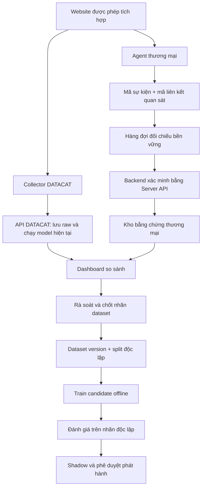

# Kế hoạch đối chiếu thương mại và huấn luyện DATACAT độc lập

Ngày lập: 24/10/2026. Trạng thái: đề xuất triển khai, chưa tích hợp dịch vụ, chưa mua gói, chưa huấn luyện hay thay model đang chạy.

## 1. Quyết định đề xuất

Giữ BiLSTM + XGBoost + heuristic hiện tại. Bổ sung một dịch vụ thương mại chạy song song để tạo bằng chứng tham khảo theo từng sự kiện. Từ bằng chứng đó, xây dataset được kiểm chứng, huấn luyện theo đợt và chỉ phát hành candidate tốt hơn trên dữ liệu độc lập.

Ưu tiên kỹ thuật là **Fingerprint Pro Plus Bot Detection**, với điều kiện nhà cung cấp cho phép mục đích nghiên cứu, benchmark và dùng kết quả để huấn luyện model riêng. Nếu không có quyền này, tiếp tục thu dữ liệu DATACAT và nhãn từ người tham gia/bot có kiểm soát; không coi việc trả phí là quyền mặc nhiên sao chép năng lực dịch vụ.

Đây là hướng học có giám sát với nhãn yếu từ bên thứ ba. Chỉ gọi là distillation theo xác suất khi thực sự có đầu ra xác suất phù hợp, được phép sử dụng và được kiểm chứng. Điểm rủi ro tổng hợp hoặc nhãn phân loại không mặc nhiên là xác suất bot đã hiệu chuẩn.

Model có thể học quy luật từ các tín hiệu DATACAT tự thu được. Nó không tự có được dữ liệu IP reputation toàn cầu, tín hiệu mạng hoặc lịch sử độc quyền mà dịch vụ dùng. Vì vậy mục tiêu là cải thiện trên phạm vi đã định nghĩa, không cam kết đạt khả năng của dịch vụ ở mọi loại bot.

## 2. Nền tảng đang có trong repo

Đã đọc lại các phần liên quan khi lập kế hoạch:

| Thành phần | Có sẵn | Việc cần bổ sung |
| --- | --- | --- |
| Collector và inference | Thu tín hiệu, đánh giá DATACAT theo snapshot | Liên kết sự kiện thương mại theo đúng phiên/lần tải trang |
| `api_service/research_labels.py` | STT bền vững, gán nhãn, revision, giữ snapshot được chọn | Kho bằng chứng nhà cung cấp và hàng đợi đối chiếu |
| `api_service/dashboard.html` | STT, verdict, Hồ sơ, nút nhãn thủ công | Cột đối chiếu, độ phủ dịch vụ, danh sách cần rà soát |
| `core_ml/dataset/export_captures.py` | Xuất raw + nhãn + manifest kiểm tra toàn vẹn | Xuất phiên bản bằng chứng, policy chọn nhãn và split |
| `core_ml/dataset/manual_labels.py` | Bỏ UNKNOWN/chưa xác minh, bỏ nhãn thương mại mặc định | Nhánh thí nghiệm nhãn yếu có trọng số và kiểm soát nguồn |
| `core_ml/train.py` | Đầu vào nhãn thủ công cho candidate diagnostic | Các thí nghiệm đối chứng, đánh giá field validation/test |

Nguồn `commercial_tool` hiện có trong giao diện là cách ghi nhận nguồn gán nhãn; nó chưa phải một tích hợp API thương mại. Không chỉ bật `allow_weak_labels=True` rồi coi bài toán đã hoàn tất.

## 3. Chọn nhà cung cấp

| Lựa chọn | Mức phù hợp với giai đoạn này | Điều cần xác nhận |
| --- | --- | --- |
| Fingerprint Pro Plus | Ưu tiên thử: frontend agent + Server API, ghép được từng event, không buộc chuyển toàn website qua CDN | Quyền nghiên cứu/huấn luyện, bot signal trong tài khoản, quota, schema và thời hạn lưu |
| DataDome | Phương án hai nếu thầy/trường có hỗ trợ tích hợp và tài trợ; phù hợp quan sát cả luồng request | Quyền sử dụng nhãn, monitor mode, xuất kết quả từng request; custom Protection API chỉ dành cho Premium/Enterprise theo tài liệu |
| Cloudflare Bot Management | Hợp lý khi website đã có Enterprise Bot Management và quyền truy cập log/Worker | Bot score chi tiết cần Enterprise có Bot Management; gói Free hoặc Turnstile không thay thế cùng khả năng |

Theo trang giá đọc ngày 24/10/2026, Fingerprint công bố Pro Plus từ **99 USD/tháng cho 20.000 lượt gọi**, vượt mức **4 USD/1.000 lượt**, có **trial Pro Plus 14 ngày**. Đây là giá niêm yết, không phải báo giá đã xác nhận cho tài khoản; cần kiểm tra thuế, giới hạn tốc độ và tự gia hạn. Không giả định gói Free duy trì Bot Detection sau trial. [Giá Fingerprint](https://fingerprint.com/pricing/)

Fingerprint trả các nhóm `good`, `bad`, `not_detected`; tài liệu nêu `bad` thể hiện automation chưa được xác minh là được cho phép, không tự chứng minh ý đồ xấu. Phương thức JS cần agent trên trang rồi truy vấn event từ backend. [Bot Detection](https://docs.fingerprint.com/docs/bot-detection/overview)

DataDome Protection API nhận metadata request ở backend và trả quyết định như allow/challenge. Không dùng quyết định allow làm nhãn HUMAN hoặc challenge làm nhãn BOT một cách máy móc. [Protection API](https://docs.datadome.co/reference/validate-request)

Cloudflare dùng thang 1-99, chiều cao nghiêng về người thật, khác với nhiều thang risk cao nghĩa là bot. Cần giữ nguyên ngữ nghĩa trong adapter. [Bot scores](https://developers.cloudflare.com/bots/concepts/bot-score/)

### Điều kiện sử dụng dữ liệu cần giải quyết trước trial

Trang điều khoản Fingerprint đọc được có mục 1.ii(f) hạn chế benchmarking và phát triển sản phẩm tương tự/cạnh tranh. Trang hiện ghi hiệu lực **01/11/2026**, sau ngày lập kế hoạch; chưa thể từ đó xác định điều khoản đang áp dụng cho tài khoản ngày 24/10. Cần yêu cầu nhà cung cấp xác nhận phiên bản hợp đồng và ngoại lệ nghiên cứu bằng văn bản. Chưa có xác nhận quyền tương ứng từ DataDome hoặc Cloudflare. [Điều khoản Fingerprint](https://docs.fingerprint.com/docs/terms-of-service)

Nội dung cần gửi nhà cung cấp: đây là khóa luận, traffic trên website được chủ sở hữu cho phép; muốn lưu kết quả theo sự kiện, dùng làm nhãn yếu cho model tự phát triển, công bố số liệu so sánh, giữ model sau khi dừng thuê bao; hỏi rõ quyền lưu/export/xóa và giới hạn công bố. Chỉ triển khai phần học từ kết quả khi phạm vi đó được phép. Không gửi yêu cầu thay người dùng trong bước lập kế hoạch.

## 4. Phạm vi nghiên cứu

MVP tập trung browser automation chạy JavaScript: bot phổ thông, bot giả chuột có quy luật và một nhóm giả chuột phức tạp trong bộ kiểm thử có kiểm soát. Desktop là nhóm đánh giá model chuột chính; touch/mobile và phiên không có chuột được báo cáo riêng.

Đơn vị nghiên cứu là **phiên/lần tải trang**, chứa nhiều sự kiện quan sát. STT vẫn là số phiên đăng ký, không phải số người duy nhất hay số HTTP request. Nếu muốn nhận diện toàn bộ request, kể cả bot không chạy JS, phải tích hợp log/middleware ở website hoặc edge; chỉ nhúng script không nhìn thấy mọi traffic.

Việc thêm một nhãn BOT cho phiên không có chuột không tạo ra dữ liệu để train BiLSTM chuột. Với nhóm này, trước mắt dùng heuristic có bằng chứng rõ và theo dõi riêng; chỉ nghiên cứu model profile/request khi đã thu đủ đặc trưng tại chính DATACAT và nhãn hai lớp.

## 5. Luồng dữ liệu chạy song song

1. Khi khởi tạo phiên, server cấp mã liên kết ngẫu nhiên có ràng buộc site, session, page-load và thời hạn. Chốt một `observation_id` cho lần đối chiếu.
2. Collector tiếp tục gửi snapshot vào DATACAT theo luồng hiện tại. Lưu bundle ID, timestamp và verdict của từng lần đánh giá.
3. Agent thương mại chạy độc lập, gắn metadata tương quan phù hợp API được chọn. Browser gửi mã event, không gửi một nhãn tự khai để server tin dùng.
4. Backend ghi job đối chiếu bền vững, lấy event qua Server API. Với Fingerprint v4, tài liệu hiện dùng `GET /v4/events/{event_id}` và Bearer secret ở server. Khóa schema/SDK khi triển khai, không trộn ví dụ v3 `requestId` với v4 `event_id`. [Server API](https://docs.fingerprint.com/reference/server-api)
5. Kiểm tra event thuộc workspace, đúng site/origin, nonce liên kết, thời điểm quan sát hợp lệ, chưa bị gắn sang phiên khác. IP/UA chỉ là kiểm tra hỗ trợ, không là khóa ghép vì NAT, proxy và thay IP.
6. Lưu kết quả bất biến theo event/version; response đến trễ có `observed_at` và `received_at` riêng. So sánh tại các mốc tương ứng, không so verdict lúc mới vào trang với verdict sau vài phút mà coi là cùng điều kiện.
7. Bảng dashboard hiển thị kết quả hai bên và nhãn đã duyệt. Kết quả nhà cung cấp không ghi đè verdict DATACAT hoặc nhãn người vận hành.
8. Có thể gọi lần hai ở mốc quan sát đã định trước nếu ngân sách cho phép. Không tái gọi dịch vụ mỗi heartbeat và không gán một kết quả đầu phiên cho mọi hành vi tương lai vô điều kiện.

Server API dùng `event_id` để truy xuất event, không phải nơi gửi tùy ý dataset chuột cũ rồi nhận nhãn hồi tố. Cần chạy cơ chế thu tín hiệu của nhà cung cấp trên traffic mới. Thông tin liên kết được lưu ở DB server; metadata từ browser vẫn cần xác minh. [Liên kết event](https://docs.fingerprint.com/docs/tagging-information)

## 6. Dữ liệu và API cần bổ sung

Các tên sau là đề xuất thiết kế, chưa tồn tại trong sản phẩm.

| Kho | Nội dung |
| --- | --- |
| `reference_jobs` | provider, observation_id, site/session/page-load, event ID, attempt, next_attempt_at, lease, trạng thái |
| `reference_observations` | verdict gốc, score gốc nếu có, observed_at, received_at, phiên bản schema/adapter, hash dữ liệu được phép giữ, trạng thái xác minh |
| `dataset_label_decisions` | label, mức chứng cứ, nguồn tham chiếu, người duyệt, revision, phạm vi snapshot/thời gian, lý do, trạng thái loại bỏ |
| Dataset manifest | dataset version, hashes, nguồn nhãn, split theo nhóm, feature schema, điều kiện xuất, danh sách sample bị loại |

Giữ một provider observation liên kết chính xác với một phiên/ngữ cảnh; nhiều observation có thể thuộc cùng phiên. Unique index cho `(provider, workspace, event_id)` ngăn retry tạo nhãn trùng hoặc dùng lại event cho phiên khác.

API đề xuất: đăng ký reference event cho observation; truy vấn evidence theo phiên; trang tổng hợp độ phủ; hàng đợi review; tạo bản export dataset. Dùng quyền đọc/quản trị đã có. Không mở endpoint public cho phép client tự gán `label=HUMAN`.

Dùng worker riêng xử lý job, lưu job trong MongoDB theo kiến trúc hiện có, có lease/retry/idempotency; không gọi API trả phí đồng bộ trong đường inference. Retry 429/5xx có giới hạn và jitter, tôn trọng Retry-After. Với event chưa có/không tồn tại, đối chiếu hợp đồng API và thời gian hết hạn, không retry vô hạn.

Raw capture hiện có TTL; khi chọn cohort nghiên cứu phải giữ snapshot cần thiết trước TTL bằng quy trình lưu dataset riêng, không phụ thuộc thao tác bấm nhãn kịp thời. Job/reference/export phải có chính sách xóa và tombstone để worker muộn không khôi phục dữ liệu đã xóa. Chọn thời hạn lưu theo mục tiêu nghiên cứu và thỏa thuận website.

## 7. Dashboard đề xuất

Giữ layout đang dùng. Bảng chính có STT, thời gian, trang, DATACAT, kết quả đối chiếu, nhãn dataset, trạng thái review và nút Hồ sơ/Gán nhãn. Các cột chi tiết có thể ẩn để tránh làm bảng quá rộng.

- DATACAT: HUMAN / SUSPECT / BOT theo logic đang chạy.
- Đối chiếu: BOT đã phát hiện / Không phát hiện bot / Bot được xác minh / Chưa có kết quả / Lỗi đối chiếu, theo đúng nguồn.
- Dataset: BOT / HUMAN / UNKNOWN, kèm nguồn và mức chứng cứ.
- Bộ lọc: bất đồng, thiếu kết quả đối chiếu, không có chuột, chờ review, theo study/site/lô traffic.
- Hồ sơ: timeline hai nguồn, phiên bản model, số điểm hợp lệ, thời điểm nhà cung cấp quan sát, ghi chú nhãn và lịch sử sửa.
- Tổng quan: tổng phiên, phiên được chọn đối chiếu, kết quả hợp lệ, lỗi/quota, tỷ lệ đủ dữ liệu chuột, số nhãn mạnh/yếu; mỗi tỷ lệ có mẫu số.

Không hiển thị phần trăm confidence nếu API chỉ trả nhãn. `not_detected` không đổi thành badge HUMAN. Trạng thái job như chờ API là trạng thái đối chiếu, không thêm một lớp quyết định thứ tư vào DATACAT.

## 8. Chính sách nhãn

| Bằng chứng | Cách dùng |
| --- | --- |
| Bot do mình chạy, có run log, cấu hình và ghép phiên đúng | Nhãn BOT mạnh trong phạm vi kịch bản |
| Người tham gia đã xác nhận, có mã nhóm và protocol | Nhãn HUMAN mạnh |
| Dịch vụ phát hiện automation | Nhãn BOT yếu, giữ nguồn và ngữ cảnh; có thể tuyển vào thí nghiệm sau kiểm chứng |
| Dịch vụ không phát hiện bot | UNKNOWN; chỉ xét nhãn HUMAN yếu khi có policy được đo trên đối chứng |
| Bot được nhà cung cấp xác minh là hợp lệ | Là automation nhưng có subtype riêng; không đồng nghĩa gian lận quảng cáo |
| Người mua traffic/nhà cung cấp traffic nói là bot/người | Lời khai nguồn, chưa phải nhãn mạnh |
| Hai dịch vụ đồng ý | Bằng chứng bổ sung, vẫn có thể cùng sai; không tự nâng thành ground truth |
| Đã vượt CAPTCHA/đăng nhập thành công | Tín hiệu bổ sung, không đủ để xác nhận HUMAN |
| Thiếu JS, lỗi API, hết quota, không có chuột | Không tạo nhãn người/bot từ riêng sự thiếu hụt này |

Review nên có một lượt không nhìn kết luận DATACAT để giảm thiên kiến. Có nhãn mạnh mâu thuẫn với dịch vụ thì giữ nguyên mâu thuẫn để đánh giá nhà cung cấp, không sửa ground truth cho khớp dịch vụ.

Giữ nguyên dữ liệu bị bất đồng; đây là tập quan trọng để tìm điểm mù. Không chỉ chọn những phiên hai bên cùng kết luận BOT/HUMAN, vì cách đó có thể loại chính bot khó nhất.

## 9. Thu traffic và kiểm chứng dịch vụ

Trước khi mở trial, hoàn tất code bằng fake adapter và fixture; có website được phép nhúng, API HTTPS, CSP/CORS phù hợp và lịch traffic. Bắt đầu trial khi đã sẵn sàng thu, tránh dùng hết trial trong lúc sửa tích hợp.

Đề xuất pilot ban đầu: 30-50 lần chạy cho mỗi kịch bản bot có kiểm soát; tuyển khoảng 20-30 người dùng nhiều trình duyệt/chuột/touchpad và vài tác vụ mỗi người nếu khả thi. Đây là cỡ khảo sát, không là bằng chứng đủ cho FPR production. Người thật lặp nhiều phiên vẫn là cùng một nhóm khi chia dữ liệu.

Nếu chưa có người thật mới: vẫn tích hợp, thu traffic tự nhiên UNKNOWN và chạy bot có kiểm soát; chưa kết luận đã tối ưu phân biệt người/bot, chưa tự promote candidate chỉ dựa trên bot test hoặc dữ liệu người cũ.

Thu một mẫu traffic ngẫu nhiên đại diện mọi verdict DATACAT, đồng thời một mẫu bổ sung các phiên SUSPECT/bất đồng/chuột lạ. Ghi `sampling_policy` và xác suất được chọn; báo cáo hiệu quả trên cohort đại diện riêng. Nếu chỉ hỏi dịch vụ ở SUSPECT, không đo được các bot DATACAT nhận nhầm HUMAN.

Đầu ra pilot: tỷ lệ ghép thành công; tỷ lệ JS bị chặn; kết quả provider theo nhóm nhãn mạnh; bất đồng theo kịch bản; số phiên đủ train chuột; chi phí mỗi phiên có evidence sử dụng được. Chọn nhà cung cấp theo khả năng bắt thêm bot khó trong chính benchmark này, không theo quảng cáo độ chính xác.

## 10. Kế hoạch huấn luyện

1. Đóng băng baseline, feature schema và tập đánh giá. Lưu bundle/hash/config trước mọi thay đổi.
2. Tách nhóm trước khi sinh cửa sổ: cùng người, bot run, cấu hình/bộ sinh và các snapshot chồng lấn không xuyên train/validation/test. Fingerprint dùng hỗ trợ nhóm, không coi là định danh người chắc chắn.
3. Giữ riêng bot family chưa train và một đợt traffic mới hơn để đo tổng quát hóa theo thời gian. Khi đủ website, thử giữ riêng site. Không chọn ngưỡng trên test.
4. Thí nghiệm A: retrain XGBoost bằng nhãn mạnh, giữ feature hiện có, BiLSTM cố định.
5. Thí nghiệm B: thêm nhãn thương mại đã lọc với trọng số thấp hơn nhãn mạnh; chọn trọng số trên validation. Ví dụ 1.0 cho nhãn mạnh và thử 0.1/0.25/0.5 cho nhãn yếu là lưới thí nghiệm, không là confidence đã đo.
6. Thí nghiệm C: retrain BiLSTM với cùng split, đủ cửa sổ chuột hợp lệ, đóng góp cân bằng theo phiên/nguồn. Giữ dữ liệu người cũ để kiểm tra quên kiến thức.
7. Thí nghiệm D: điều chỉnh fusion và hiệu chuẩn điểm trên validation. BotD/heuristic vẫn là logic có phiên bản; không tự học chỉ vì nhận thêm label.
8. So sánh A/B/C/D bằng cùng bộ test giữ kín. Chỉ giữ thay đổi có cải thiện đo được, lưu cả kết quả âm.

Đầu vào model chỉ chứa các đặc trưng DATACAT có thể tiếp tục thu sau khi dừng thuê bao. Tuyệt đối loại provider verdict/score/visitor ID độc quyền, reviewer, nguồn nhãn, STT, mã bot, mã lô khỏi feature. Không gửi dự đoán DATACAT vào chức năng feedback của nhà cung cấp rồi dùng phản hồi đó làm nhãn độc lập.

Nhãn là mục tiêu dự đoán, không là feature. Ví dụ một phiên fake-mouse bị DATACAT nhận HUMAN nhưng run log xác nhận BOT: cửa sổ chuột hợp lệ được lưu với nhãn BOT và đưa vào train nếu thuộc nhóm train; khả năng phát hiện phải được đo trên run/cấu hình khác đã giữ riêng.

Không gán kết luận quan sát muộn vào mọi cửa sổ đầu phiên mà không có chính sách: thiếu thông tin ở đầu phiên là điều kiện thực tế. Đo theo mốc thời gian và số điểm, giữ nhãn nguồn đúng phạm vi, cho phép SUSPECT khi chưa đủ bằng chứng.

## 11. Đánh giá và điều kiện phát hành

Các chỉ số bắt buộc, tính theo phiên và theo thời điểm, tách nhãn mạnh khỏi nhãn yếu:

- BOT -> HUMAN: bỏ sót nguy hiểm; báo cáo số phiên từng bị HUMAN và verdict cuối phiên.
- HUMAN -> BOT: nhận nhầm người; báo cáo số phiên từng bị BOT và verdict cuối phiên.
- Recall BOT = BOT được nhận BOT / toàn bộ BOT có nhãn, bao gồm cả BOT đang SUSPECT trong mẫu số.
- Tỷ lệ SUSPECT trên từng lớp và tỷ lệ phiên ra được quyết định; không làm đẹp accuracy bằng việc loại SUSPECT.
- Precision BOT, confusion matrix ba đầu ra, thời gian/số điểm tới kết luận, quyết định dao động.
- Độ phủ collector/provider và nhóm không có chuột; dữ liệu không chạy JS phải có mẫu số server riêng nếu có tích hợp.
- Chi phí API, độ trễ thu evidence, hiệu năng inference DATACAT và lỗi theo browser/device/bot family.

Ngưỡng chấp nhận phải chốt trước lượt test cuối. Mục tiêu khởi đầu: giảm BOT -> HUMAN so với baseline trên cùng tập độc lập, không tăng HUMAN -> BOT vượt biên chấp nhận đã chốt trên validation, SUSPECT không phình ra để che lỗi. Dùng khoảng tin cậy/bootstrap theo người/run, không coi hàng nghìn cửa sổ tương quan là hàng nghìn mẫu độc lập.

Không có lỗi trên một nhóm nhỏ người thật không chứng minh FPR bằng 0. Nếu chưa có gold test đủ lớn, kết luận chỉ là phù hợp pilot quan sát, chưa đủ căn cứ bật chặn tự động. Tỷ lệ đồng ý với dịch vụ là chỉ số agreement, không phải accuracy thật.

Release gate gồm regression hiện có, replay sâu, test data leakage, review nhãn, so sánh candidate/baseline, và thử chạy không có kết nối nhà cung cấp. Candidate chạy shadow trước, có rollback bundle. Giữ test cuối chưa dùng chọn model; khi đã nhìn nhiều lần thì cần cohort test mới.

## 12. Những trường hợp phải kiểm thử

| Trường hợp | Hành vi cần đạt |
| --- | --- |
| Dịch vụ timeout/429/quota hết | DATACAT vẫn đánh giá; evidence báo thiếu/lỗi, không gán HUMAN |
| Event ID giả, tái dùng hoặc thuộc site khác | Từ chối liên kết, không đưa vào dataset |
| Hai tab/SPA/reload | Page-load/observation phân biệt, không lẫn evidence |
| Cùng IP, khác người | Không join bằng IP đơn độc |
| Event đến trễ hoặc đổi thứ tự | Timeline theo observed_at; không ghi đè lịch sử |
| Hai kết quả thương mại mâu thuẫn | Giữ hai evidence, chuyển review; không lấy latest/max tùy tiện |
| Webhook gửi lại/worker chết giữa chừng | Dedupe, lease khôi phục; không nhân bản label |
| Người thật dùng VPN/adblock/touch/ít chuột | Không tự coi đặc điểm đó là BOT hoặc HUMAN |
| Collector/agent bị chặn | Ghi nhận thiếu độ phủ; không bịa dữ liệu chuột |
| Traffic bị chặn ở CDN trước JS | Ghi cohort edge riêng nếu có quyền log, tránh bỏ sót mẫu số |
| Nhà cung cấp challenge làm thay đổi chuột | Tách trước/sau challenge; pilot ưu tiên chỉ quan sát |
| Người chuyển sang automation giữa phiên | Xem nhãn theo đoạn thời gian, không phủ nhãn toàn phiên |
| TTL raw hết trước reference về | Pin cohort trước TTL hoặc loại sample với lý do rõ |
| Xóa phiên khi worker đang lấy evidence | Tombstone ngăn dữ liệu bị tạo lại |
| Người sửa nhãn trong lúc export/train | Snapshot dataset version cố định, revision audit |
| Schema provider đổi/mất field | Adapter fail rõ ràng, không mặc định not_detected |
| Nhiều bot cùng bộ sinh áp đảo dataset | Cân bằng theo nhóm, chặn leakage và sample poisoning |
| Ngừng dịch vụ hoàn toàn | Model vẫn chạy với feature nội bộ, dashboard chỉ mất cột đối chiếu |

## 13. Chi phí và nhịp cập nhật

Trong pilot nhỏ có thể đối chiếu mỗi phiên một lần, thêm lần sau theo protocol. Khi tăng traffic, đặt trần ngày/tháng, cảnh báo và lấy mẫu đại diện. API đọc event không bị tính vào allowance theo tài liệu Fingerprint, nhưng lần identification tạo event được tính theo gói; vẫn phải tôn trọng rate limit. [Server API](https://docs.fingerprint.com/reference/server-api)

Ví dụ dự toán theo giá niêm yết: 20.000 identification nằm trong 99 USD/tháng; 30.000 identification khoảng 139 USD/tháng trước thuế/phí khác. Nếu gọi hai lần mỗi phiên thì số phiên được bao phủ giảm tương ứng. Đây là phép tính dự toán, cần xác nhận hạn mức tài khoản.

Mỗi ngày: kiểm tra lỗi/chi phí, xuất dữ liệu và review mẫu ưu tiên. Theo tuần hoặc khi có đủ nhóm mới: tạo dataset version và train candidate. Không tự cập nhật weights sau mỗi request. Có thể tự động hóa job train/eval, nhưng phát hành yêu cầu gate đã đạt và phê duyệt.

Khi model đủ tốt trong phạm vi nghiên cứu: giảm tỷ lệ gọi nhà cung cấp để audit, rồi tắt hẳn agent/API bằng feature flag. Giữ kiểm thử bot có kiểm soát và lấy mẫu người thật; không còn giáo viên không có nghĩa hệ thống tự có nhãn thật cho các kiểu bot mới.

## 14. Thứ tự triển khai và đầu ra

Ước lượng thời gian là thời gian làm việc sau khi có quyền tích hợp; thời gian chờ đối tác/traffic không tính vào số ngày lập trình.

| Giai đoạn | Công việc | Đầu ra / điều kiện hoàn tất |
| --- | --- | --- |
| 0: 1-2 ngày, cộng thời gian chờ đối tác | Chốt website, quyền dữ liệu/benchmark/train, scope và quota | Đồng ý của website và nhà cung cấp; protocol pilot |
| 1: 2-3 ngày | Adapter giả lập, event contract, durable jobs, join/replay/delete | Test các lỗi tích hợp chạy pass, không ảnh hưởng inference |
| 2: 1-2 ngày | Agent thương mại + API thật trên staging | Ghép đúng 100% fixture đã biết; đo missing/error trên pilot |
| 3: 1-2 ngày | Dashboard so sánh, review, export evidence | Nhìn rõ AI/reference/nhãn, export kiểm chứng được |
| 4: 1-2 tuần hoặc theo lịch thầy | Traffic thật + bot có kiểm soát + người đối chứng | Dataset v1 và báo cáo chất lượng nhãn/độ phủ |
| 5: 3-5 ngày, tùy compute | Các ablation XGBoost, nhãn yếu, BiLSTM, fusion | Model candidate, bảng so sánh và lý do chọn/loại |
| 6: sau khi đủ test | Shadow, test mới và tắt kết nối provider | Báo cáo độc lập; promote nếu đạt, giữ baseline nếu không |

Thứ tự sửa module: reference adapter/storage -> worker và capture join -> dashboard -> export/versioning -> loader nhãn yếu có kiểm soát -> training/evaluation -> release gate. Tránh sửa đồng thời kiến trúc model và policy nhãn vì sẽ khó xác định nguyên nhân cải thiện.

## 15. Phần có thể bắt đầu ngay

1. Chốt protocol và định nghĩa nhãn, làm fixture bằng chứng giả lập từ schema công khai.
2. Xây adapter có thể tắt, durable jobs, kiểm tra ghép đúng phiên và dashboard đối chiếu.
3. Chuẩn bị benchmark bot có nhãn, mẫu người tham gia và pipeline export có version.
4. Sau khi có website và quyền dùng kết quả, bật trial ở staging rồi thu traffic thật.
5. Chỉ bắt đầu retrain với nhãn thương mại khi đã đo chất lượng nguồn và có gold validation/test phù hợp.

Nếu nhà cung cấp không cho phép dùng kết quả để train/benchmark, hướng khả thi vẫn là thu raw do mình kiểm soát, tạo nhãn từ người tham gia và bot có log, tiếp tục tối ưu bằng dataset đó. Không đổi tên nguồn nhãn để vượt hạn chế kỹ thuật hoặc điều khoản.

## Nguồn chính thức

- [Fingerprint Bot Detection](https://docs.fingerprint.com/docs/bot-detection/overview): kết quả, luồng agent/backend và giới hạn phương thức thu.
- [Fingerprint pricing](https://fingerprint.com/pricing/): giá và trial công bố tại lúc tra cứu.
- [Fingerprint Server API](https://docs.fingerprint.com/reference/server-api): event API v4, xác thực, lỗi và rate limit.
- [Fingerprint linking/tagging](https://docs.fingerprint.com/docs/tagging-information): liên kết metadata của ứng dụng.
- [Fingerprint terms](https://docs.fingerprint.com/docs/terms-of-service): mục hạn chế sử dụng; chú ý ngày hiệu lực nêu trong phần 3.
- [DataDome integrations](https://docs.datadome.co/docs/integrations): client/server integration và quyền log enrichment.
- [DataDome Protection API](https://docs.datadome.co/reference/validate-request): điều kiện custom API và ngữ nghĩa quyết định.
- [Cloudflare bot scores](https://developers.cloudflare.com/bots/concepts/bot-score/): thang điểm, bot grouping và điều kiện Enterprise.

Các mục kiến trúc, số lượng pilot, lịch triển khai, trọng số nhãn yếu và release gate là đề xuất cho DATACAT, không phải tính năng hoặc cam kết hiệu quả của nhà cung cấp.
